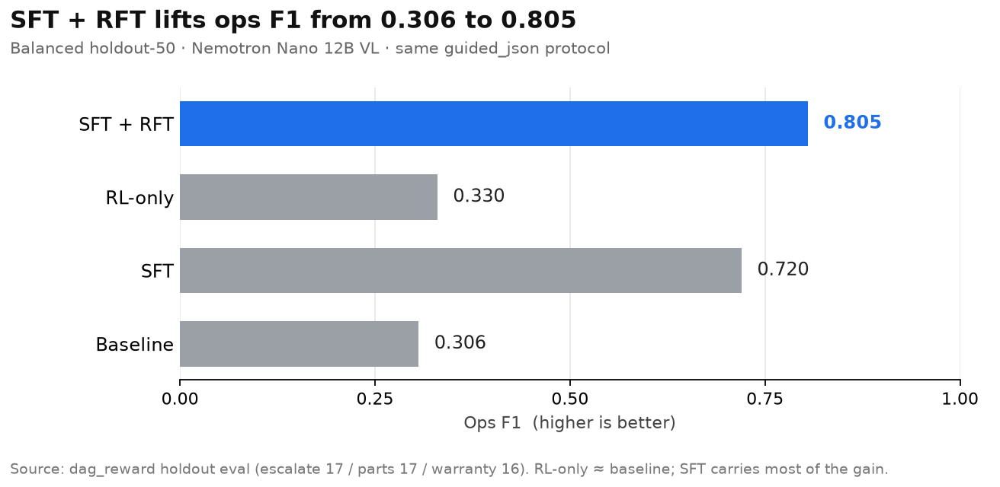

# Flowstate

Teach a support SOP once from an expert screen recording. Get an executable DAG. Run it on cases.

Hackathon stack: NVIDIA Nemotron Nano 12B v2 VL → Red Hat vLLM on Brev → NeMo Gym scoring → Flowstate web app. Inference is NVIDIA / Brev / local vLLM only.

Challenge track: Fine-tuned & Specialized (~12.6B, under the 33B cap).

Headline: ops F1 0.306 → 0.805 on balanced holdout-50 with product SFT + RFT (same `guided_json` protocol).

## Bounty write-ups

| Bounty | Doc |
|--------|-----|
| Best Use of NVIDIA Nemotron Lightning | [`docs/bounties/nemotron-lightning.md`](docs/bounties/nemotron-lightning.md) |
| Best Model Improvement With NeMo Gym | [`docs/bounties/nemo-gym.md`](docs/bounties/nemo-gym.md) |
| Best Use of Red Hat vLLM | [`docs/bounties/redhat-vllm.md`](docs/bounties/redhat-vllm.md) |

## Results (balanced holdout-50)

Base Nemotron VL vs product SFT vs RL-only vs SFT + RFT. Scorer: `dag_reward` (`scripts/nemo_rl_gt.py`). Numbers below are from one holdout-50 draw (escalate 17 / parts 17 / warranty 16). Live eval re-samples 50 from the validation pool each run (see How to run §3).

Ops F1 is the harmonic mean of precision and recall over critical registry ops on each video. Gold set `G` is the family-defining ops for the filmed path; pred set `P` is the ops in the model's DAG. 

Precision = `|G ∩ P| / |P|`

Recall = `|G ∩ P| / |G|`

F1 = `2·P·R / (P+R)`

High F1 means the model named the right tools for the branch that was filmed and did not invent extras. Schema can still look fine when F1 is low.



| Metric | Baseline | SFT | RL-only | SFT + RFT |
|--------|----------|-----|---------|-----------|
| Mean reward | 0.587 | 0.814 | 0.615 | 0.881 |
| Schema OK | 0.940 | 0.980 | 1.000 | 1.000 |
| Critical ops recall | 0.224 | 0.780 | 0.238 | 0.880 |
| Taken branch | 0.520 | 0.720 | 0.540 | 0.820 |
| Ops precision | 0.481 | 0.668 | 0.536 | 0.742 |
| Ops recall | 0.224 | 0.780 | 0.238 | 0.880 |
| Ops F1 | 0.306 | 0.720 | 0.330 | 0.805 |

What each metric means:

- Mean reward: weighted score `0.4·schema_ok + 0.3·critical_ops_recall + 0.3·taken_branch` (the scalar `dag_reward` optimizes).
- Schema OK: fraction of predictions that validate as a registry-legal DAG after guided decode.
- Critical ops recall: share of gold critical ops that appear in the prediction (same as ops recall).
- Taken branch: 1 when the filmed branch tip op is in the prediction (e.g. Active → `CREATE_REPAIR`), else 0; reported as the holdout mean.
- Ops precision: of the ops the model emitted, how many were in the gold critical set (`|G ∩ P| / |P|`).
- Ops recall: of the gold critical ops, how many the model emitted (`|G ∩ P| / |G|`).
- Ops F1: harmonic mean of ops precision and ops recall; balances inventing extras vs missing required tools.

Per-procedure mean reward:

| Procedure | Baseline | SFT | RL-only | SFT + RFT |
|-----------|----------|-----|---------|-----------|
| Escalate (17) | 0.610 | 0.760 | 0.630 | 0.850 |
| Parts (17) | 0.610 | 0.790 | 0.620 | 0.840 |
| Warranty (16) | 0.538 | 0.898 | 0.594 | 0.955 |
| Overall (50) | 0.587 | 0.814 | 0.615 | 0.881 |

## How to run

### 1. App against live SFT on Brev

```bash
cp .env.example .env   # BREV_INSTANCE_NAME, LOCAL_VLLM_API_KEY, MODEL_ID

# on teachonce-gpu:
bash scripts/bootstrap_brev.sh          # once
bash scripts/start_vllm_sft.sh          # merged SFT Nemotron VL on :8000

# on Mac:
./scripts/tunnel_vllm.sh                # localhost:8101 → VM:8000
cd teachonce-web && VLLM_BASE_URL=http://127.0.0.1:8101/v1 ./run.sh
# http://localhost:8000  ·  API docs at /docs
```

Smoke:

```bash
bash scripts/smoke_test.sh
# optional Gym MCQA: RUN_GYM=1 bash scripts/smoke_test.sh
```

### 2. NeMo Gym (on GPU box)

```bash
bash scripts/start_gym.sh
bash scripts/smoke_gym_nemotron_vl.sh
```

### 3. Holdout eval (on GPU box, vLLM up)

Each run draws 50 videos at random from the validation pool (`gt_train_balanced100.jsonl` by default). A new seed is chosen every time unless you set one. The result JSON records `seed` and `sample_ids`.

| Knob | Env / flag | Default |
|------|------------|---------|
| Pool | `EVAL_GT` / `--gt` | `data/generated/nemo_rl/gt_train_balanced100.jsonl` |
| Sample size | `EVAL_N` / `--max-samples` | `50` |
| Seed | `EVAL_SEED` / `--seed` | new random draw each run |

```bash
# fresh random holdout-50 (prints seed=… at start)
python scripts/baseline_vllm_dag.py

# reproduce a prior draw
EVAL_SEED=12345 python scripts/baseline_vllm_dag.py

# SFT vs baseline through the same sampler
bash scripts/eval_sft_vs_baseline.sh
EVAL_SEED=12345 bash scripts/eval_sft_vs_baseline.sh
```

More detail: [`docs/brev.md`](docs/brev.md) · [`docs/training-design.md`](docs/training-design.md) · [`docs/rl-vllm-gym-architecture.md`](docs/rl-vllm-gym-architecture.md).

## Demo

| Item | Path |
|------|------|
| 3–5 min video script | [`demo/VIDEO_SCRIPT.md`](demo/VIDEO_SCRIPT.md) · [`demo/FLOWSTATE_75S_SCRIPT.md`](demo/FLOWSTATE_75S_SCRIPT.md) |
| Example SOP | [`demo/SOP-CS-214_Laptop_Warranty.md`](demo/SOP-CS-214_Laptop_Warranty.md) |
| Web app | [`teachonce-web/`](teachonce-web/) |

## Repo map

| Path | What |
|------|------|
| `teachonce-web/` | Flowstate UI + API + vLLM model client |
| `scripts/` | vLLM/Gym bootstrap, SFT, eval, `dag_reward` |
| `configs/` | NeMo-RL + Gym sketch |
| `docs/bounties/` | Submission one-pagers |
| `docs/figures/` | Holdout result charts |
| `demo/` | Video scripts + example SOP |

## Submission checklist

- [ ] GitHub repo link (this repo)
- [ ] Project description (this README + bounty docs)
- [ ] 3–5 minute demo video (record from `demo/` scripts)
- [ ] Point judges at the three bounty docs above
