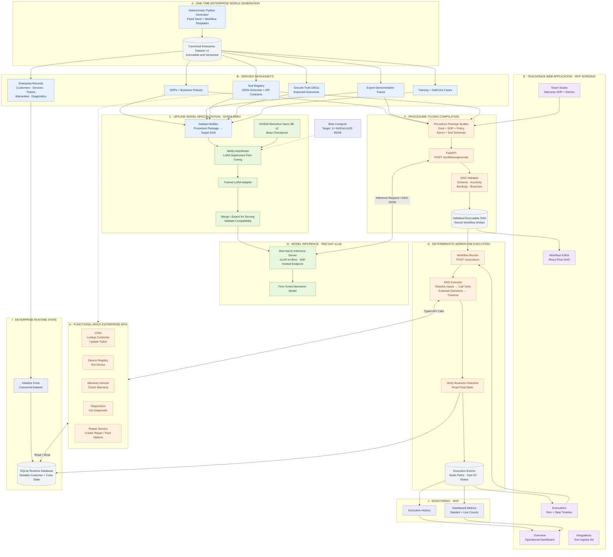

# TeachOnce — High-Level Design (HLD)

**Status:** Architecture reference  
**Companion docs:** [`plan.md`](plan.md) (product + implementation plan), [`lld.md`](lld.md) (schemas, APIs, component internals)  
**Audience:** Engineers, judges, collaborators who need the system shape without implementation detail  

---

## 0. Mandatory NVIDIA-only AI policy

TeachOnce uses **NVIDIA models exclusively** for every AI training and inference workload (including any optional NL augmentation). Full policy text: [`plan.md`](plan.md) § Mandatory NVIDIA-only AI infrastructure policy.

| Allowed | Forbidden |
|---------|-----------|
| Nemotron Nano 9B v2 on Brev via Red Hat vLLM | OpenAI, Anthropic/Claude, Gemini, Groq, OpenRouter, Together, Fireworks |
| NeMo AutoModel LoRA on Brev A100 | Cursor-hosted model APIs as an app dependency |
| FastAPI → self-hosted `NVIDIA_VLLM_BASE_URL` | External LLM fallbacks; teacher models outside NVIDIA infra |
| OpenAI-**compatible protocol** to **our** Brev endpoint | Default `api.openai.com` (or similar) env/SDK defaults |

Frontend never calls an AI provider. Cursor may be used as an IDE only.

---

## 1. Purpose

TeachOnce turns enterprise procedural knowledge into **executable, inspectable workflow automations**.

| Layer | Responsibility |
|-------|----------------|
| Fine-tuned Nemotron | Compile Procedure Package → typed DAG JSON |
| Deterministic platform | Validate DAG, execute against mock enterprise APIs, persist state, monitor |

The HLD describes major subsystems, data ownership, trust boundaries, and end-to-end flows. It does not specify field-level schemas (see LLD).

---

## 2. Design goals

1. **One coherent enterprise world** — all screens, tools, training data, and demos share one frozen dataset.  
2. **Genuine NVIDIA model contribution** — live generate path uses fine-tuned Nemotron via Red Hat vLLM on Brev; no hardcoded DAG and no third-party LLM in the final demo.  
3. **Deterministic execution** — the GPU is not on the execution hot path; tools and decisions are real and inspectable.  
4. **Demo-ready polish** — UI matches the TeachOnce enterprise mock; Flows A–C are reliable.  
5. **Minimal infra** — single Brev GPU instance + FastAPI + React; no Kubernetes.  
6. **NVIDIA-only AI** — one centralized inference gateway; hard-fail if Brev endpoint is unset.  

### Non-goals (MVP)

Second SOP families, Test Lab, Review Queue, multi-agent orchestration, real CRM/ITSM, SSO, video understanding, advanced recovery, multi-tenant SaaS hardening, any non-NVIDIA hosted LLM, any edge-case recovery beyond one compile retry.

**MVP ship bar:** Flows A–C on one warranty DAG. Everything else is distraction.

---

## 3. Locked technology choices

| Concern | Choice |
|---------|--------|
| Training / GPU | NVIDIA Brev, **1× A100 80GB**, ~$160 credits |
| Base model | `nvidia/NVIDIA-Nemotron-Nano-9B-v2` (9B) |
| Fine-tuning | NeMo AutoModel LoRA (recipe: `nemotron_nano_9b_squad_peft.yaml` adapted) |
| Serving | Red Hat AI Inference Server (vLLM) on Brev; **merge LoRA** before serve (Mamba constraint) |
| App → model | FastAPI `services/nvidia_inference.py` → `NVIDIA_VLLM_BASE_URL` only |
| Runtime DB | SQLite (seeded from canonical dataset) |
| Frontend | React + TypeScript + Tailwind + React Flow + Recharts (no direct AI calls) |
| Parameter budget | Single 9B generative model (under 33B cap) |
| Prohibited AI | OpenAI / Anthropic / Gemini / Groq / OpenRouter / Together / Fireworks / Cursor model APIs |

---

## 4. System context

```text
┌─────────────────────────────────────────────────────────────────┐
│                     Support Operations Manager                    │
└─────────────────────────────┬───────────────────────────────────┘
                              │
                              ▼
┌─────────────────────────────────────────────────────────────────┐
│                    TeachOnce Web Application (MVP)                │
│  Overview · Teach Studio · Workflow Editor · Executions · Integ.  │
└─────────────────────────────┬───────────────────────────────────┘
                              │ HTTPS / JSON
                              ▼
┌─────────────────────────────────────────────────────────────────┐
│                         FastAPI Backend                           │
│  Procedure package · Generate · Validate · Execute · Metrics      │
└───────┬─────────────────────────────┬───────────────────────────┘
        │ NVIDIA gateway              │ Typed tool calls
        │ (OpenAI-compat protocol     │
        │  → our Brev URL only)       │
        ▼                             ▼
┌───────────────────┐     ┌───────────────────────────────────────┐
│ Red Hat vLLM      │     │ Mock enterprise adapters + SQLite     │
│ Fine-tuned Nano   │     │ CRM · Device · Warranty · Diag · Repair│
│ 9B on NVIDIA Brev │     │ Seeded from canonical dataset         │
└───────────────────┘     └───────────────────────────────────────┘

Offline (Brev): Dataset → NeMo AutoModel LoRA → merge → deploy to Red Hat vLLM
No third-party LLM providers anywhere on this diagram.
```

---

## 5. Logical architecture (subsystem view)



---

## 6. Subsystem responsibilities

### A–B · Canonical enterprise world

- One deterministic generator (fixed seed) produces versioned `data/generated/`.  
- **MVP:** warranty-only entities, one SOP/policy/demo, one ground-truth DAG, two demo cases, small train JSONL.  
- **Immutable** after freeze; checksummed via `manifest.json`.  

### C · Offline model specialization (Brev)

- Builds instruction pairs: Procedure Package → target DAG.  
- LoRA SFT on Nano 9B via NeMo AutoModel.  
- Exports adapter, **merges** for vLLM-compatible artifact.  

### D · Model inference (Red Hat vLLM on Brev)

- Serves merged fine-tuned **NVIDIA Nemotron** on Brev.  
- Self-hosted endpoint may speak an OpenAI-compatible **protocol**; traffic never leaves approved NVIDIA infra.  
- Used only for **compilation** (and optional NVIDIA-hosted NL augmentation), not for tool execution.  

### E · Web application

- Teach Studio initiates generation; Editor renders real DAG JSON; Executions drive runs; Overview shows seeded + live metrics.  
- **No browser → LLM provider** calls; all AI goes through FastAPI’s NVIDIA gateway.  
- **MVP screens only** — no Test Lab, no Review Queue.  

### F · Procedure-to-DAG compilation

- Assembles Procedure Package from canonical assets.  
- `POST /workflows/generate` → `nvidia_inference` → Brev Red Hat vLLM → validator → stored workflow.  
- Invalid model output is rejected (optionally one repair retry via the **same** NVIDIA endpoint); never silently replaced with ground truth in demo; never falls over to a third-party LLM.  

### G · Deterministic execution

- Traverses validated DAG; resolves bindings; calls tools; evaluates decisions; verifies outcomes; emits event log.  
- No GPU on this path.  

### H–I · Mock enterprise APIs + runtime state

- Functional adapters with typed contracts.  
- SQLite seeded from entities; mutations (repair orders, ticket updates) persist and surface in UI.  
- `POST /admin/reset` restores seed without regenerating the world.  

### J · Monitoring

- Execution history and live vs seeded metrics feed Overview.  
- No separate Test Lab in MVP.

---

## 7. Data ownership and trust

| Data | Owner | Mutability | Consumers |
|------|-------|------------|-----------|
| Canonical dataset | Generator + freeze process | Immutable | Training, seed, UI packages, expected outcomes |
| LoRA / merged weights | ML pipeline on Brev | Versioned artifacts | Red Hat vLLM |
| Stored workflows | FastAPI | Append / activate | Editor, executor |
| Runtime enterprise state | SQLite via tools | Mutable | Tools, verify step, UI |
| Execution events | Executor | Append-only | Executions UI, Overview |

**Integrity rule:** If case `CS-*` references customer `C-*` and device `D-*`, those IDs must resolve identically in dataset files, SQLite, tool responses, and UI.

---

## 8. Primary user journeys (HLD)

### Flow A — Teach → Generate

Teach Studio loads Procedure Package → Generate → NVIDIA gateway → Brev Red Hat vLLM compiles DAG → validator → Workflow Editor.

### Flow B — Execute (active warranty)

Activated DAG + active-warranty case → executor → tools create repair + update ticket → timeline + artifact visible → Overview updates.

### Flow C — Execute (expired warranty)

Same DAG + expired-warranty case → `RECORD_PAID_OPTIONS` + ticket update (no `CREATE_REPAIR`) → Overview shows second run.

---

## 9. Deployment topology (MVP)

```text
┌──────────────── NVIDIA Brev (1× A100 80GB) ────────────────┐
│  Red Hat AI Inference Server (merged Nano 9B)                 │
│  Optional: FastAPI + SQLite on same VM for demo simplicity    │
└───────────────────────────────────────────────────────────────┘
         ▲
         │ Self-hosted NVIDIA_VLLM_BASE_URL
         │ (OpenAI-compatible protocol → our host only)
┌────────┴────────┐     or FastAPI on laptop pointing at Brev
│ Operator laptop │
│  React frontend │     (frontend never calls LLM providers)
└─────────────────┘
```

- Stop Brev instances when idle; reserve credits for live demo.  
- No multi-node cluster.  
- No OpenAI / Anthropic / Gemini / Cursor model endpoints in any deploy env.  

---

## 10. Cross-cutting concerns

| Concern | Approach |
|---------|----------|
| AI providers | NVIDIA-only; centralized gateway; allowlist hosts/model IDs; hard-fail if unset |
| Security | Demo trust boundary; no SSO; no real PII — synthetic Northstar data only |
| Observability | Inference latency on generate; execution event log; basic dashboard counts |
| Honesty | Label seeded vs live metrics; do not claim measured SOTA |
| Reset | Admin reset of runtime DB from frozen dataset |
| Failure modes | Invalid DAG → UI error; tool failure → failed execution + visible node; no autonomous recovery; **no** external LLM fallback |

---

## 11. Quality bars for architecture acceptance

- Model path is real (Brev train → Red Hat vLLM → `/workflows/generate`) and **NVIDIA-only**.  
- Executor path is real (DAG-driven tool calls against SQLite).  
- Single dataset backs train, seed, and demo cases.  
- Flows A–C work without swapping in disconnected fixtures.  
- App runs without OpenAI / Anthropic / Google / Cursor / other third-party LLM API keys.  

Detailed schemas, endpoint contracts, and module boundaries: [`lld.md`](lld.md).

---

## Document history

| Date | Change |
|------|--------|
| 2026-10-17 | Initial HLD with full subsystem diagram and locked Brev / Nano 9B / Red Hat vLLM choices |
| 2026-10-17 | Enforced Mandatory NVIDIA-only AI policy across architecture and deployment notes |
| 2026-10-17 | MVP cut: warranty-only A–C screens; drop Test Lab / Review Queue / multi-family scope |
