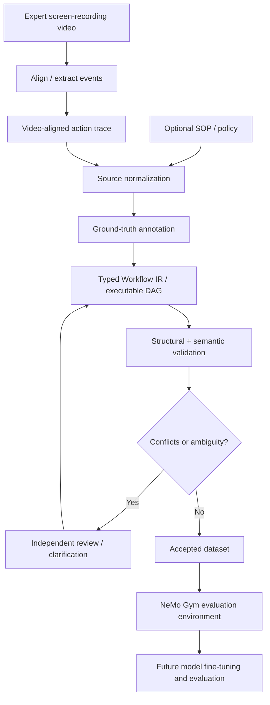
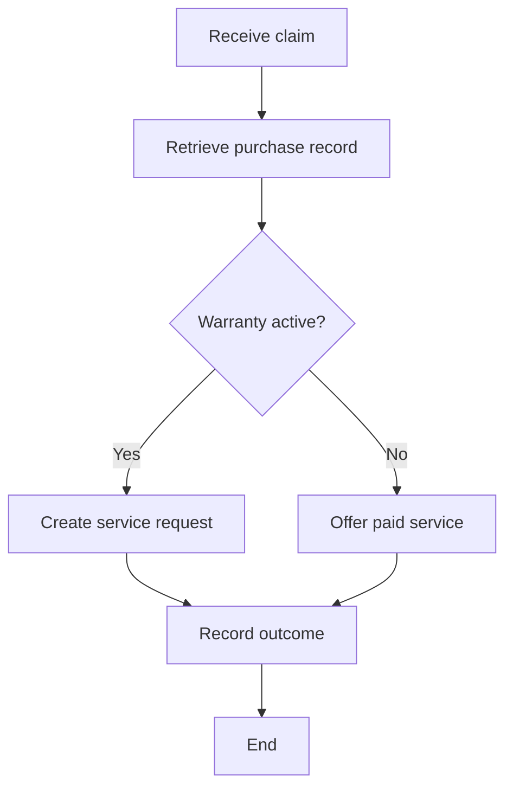
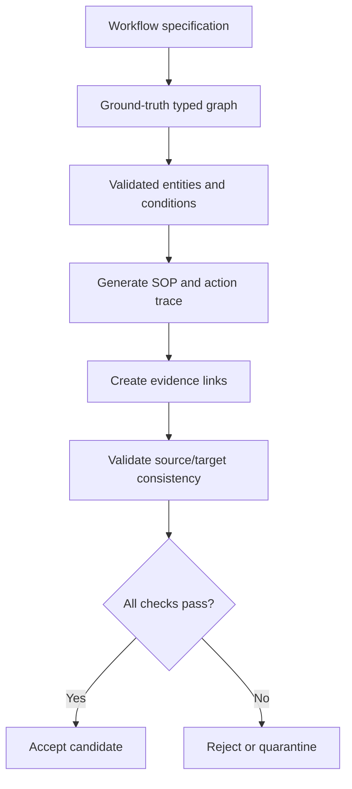

# Phase 1 — Ground-Truth Workflow Intelligence Dataset

**Status:** `not_started`  
**Last updated:** 2026-10-17  
**Depends on:** Phase 0 done  
**Blocks:** Phase 2 (Nemotron train/eval needs IR JSONL + Gym env)  
**Living tracker:** [`../implementation.md`](../implementation.md)  
**Product contract:** [`../plan.md`](../plan.md) · **Primary path: expert video → DAG** (Teach Studio)

---

## How to maintain this doc

1. Flip checkboxes as work lands.  
2. Update **Status** / **Working log**.  
3. Put schema details that stabilize into [`../dataset-ir.md`](../dataset-ir.md) (create when schema lands).  
4. Put public-dataset findings into [`../source-coverage.md`](../source-coverage.md) *(optional; not on critical path)*.  
5. Do **not** mark the dataset “perfect” because validators passed — record structural vs semantic vs compilation readiness separately.

---

## Mission

Construct a **high-quality, fully validated** training and evaluation dataset for converting **expert screen-recording videos** (plus video-aligned demonstration traces, optional SOP/policy) into **typed, provenance-aware workflow graphs** (Workflow IR → executable DAG).

We will **not** fine-tune until the dataset passes rigorous structural, semantic, and consistency checks.

**Quality over size.** **Product north star: video → DAG** via **Nemotron Nano 12B v2 VL** (`…-VL-BF16`, 12.6B).

### Align with TeachOnce product (mock UI)

Dataset records must be able to represent:

1. **Expert screen-recording video** as primary teach asset  
2. **Video-aligned** structured demonstration trace (events ↔ timestamps)  
3. Optional SOP / policy as secondary context  
4. Actions and entities  
5. Decision points  
6. Data and control dependencies  
7. Preconditions / postconditions  
8. Tool requirements (registry ops — APIs/modules; UI click tools only if registered)  
9. Documented / demonstrated / inferred attribution (demo evidence tied to video)  
10. Missing info and unsupported assumptions  
11. Human clarification of ambiguity  
12. Compilation into a validated workflow graph  
13. Graph validation / simulation readiness  
14. Later execution auditability  

This is a **video-taught workflow compiler foundation**, not an SOP summarizer and not open-web RPA.

### Out of scope this phase

- Fine-tuning / RL training  
- Open-web agent corpora as graph GT (Mind2Web / WebLINX / WONDERBREAD)  
- End-to-end raw-pixels→DAG without a structured trace *(stretch later)*  
- Frontend changes  
- Reinstalling Brev / vLLM / Gym  

---

## Architecture



**Target = structured Workflow IR + executable DAG.** Every train row should name its **source video** and aligned trace. Do not reduce ground truth to a bare edge list.

---

## Locked hackathon scope

| In | Out |
|----|-----|
| Full Workflow IR v1 schema (sections A–L below) | 10 fully populated research domains |
| Open **screen-recording** corpora (video + action logs) as volume | LLM invents graph from text with no video grounding |
| 1 audited **warranty gold** (our video or closest public clip + DAG over **our** tool registry) | Treating click/RPA labels as TeachOnce DAG GT without remapping |
| MVP exit: video→DAG train/val JSONL (public videos + mapped IR) | Fabricated tool I/O not backed by world |
| Thin NeMo Gym `teachonce_ir` eval | Full RL / open-web click agents |

**MVP domain (critical path):** warranty only (video + aligned trace → one DAG topology).  

**Stretch families (after warranty gold):** invoice→spreadsheet · expense approval · ticket routing  

**Patterns:** linear · conditional · human approval · fork-join · missing prerequisite / unresolved branch · labeled invalid (cycle, unreachable)

**Bounty alignment:** Dataset + Gym path supports **Best Model Improvement With NeMo Gym**. Product model path (Phase 2) is **Nemotron** (not Phase 0 smoke Qwen).

---

## Deliverable layout

```text
docs/
  phases/phase-1-dataset.md     # this file
  dataset-ir.md                 # schema rationale + review rubric (create with schema)
  source-coverage.md            # public dataset matrix (create after inspect)
data/
  schema/
    workflow_ir.schema.json
  generated/
    manifest.json
    records/*.json              # full IR per record
    splits/{train,val,test}.jsonl
    quarantine/                 # failed validation + diagnostics
scripts/
  generate_workflow_ir.py
  validate_workflow_ir.py
  review_checklist.py
# NeMo Gym resources (path TBD to match installed Gym layout)
  teachonce_ir/                 # tasks + verifier
```

Also produce a **derived executable DAG view** (subset compatible with [`../lld.md`](../lld.md)) for later runtime — never a substitute for IR.

---

## Stage checklist

### 1.1 Schema — Workflow IR v1

- [ ] Pydantic models for full record  
- [ ] JSON Schema (`data/schema/workflow_ir.schema.json`)  
- [ ] Document field meanings; allow explicit null/empty  
- [ ] Document path semantics: control-flow = possible paths; branches not always both executed  
- [ ] Write [`../dataset-ir.md`](../dataset-ir.md)

#### A. Record / source metadata

`workflow_id`, `record_id`, `schema_version`, `workflow_title`, `workflow_domain`, `workflow_description`, `source_dataset`, `source_record_id`, `source_license`, `source_attribution`, `generation_method`, `annotation_method`, `annotation_version`, `review_status`, `split`, `template_family_id`, `random_seed`

Record whether example is: public human demo · public SOP · synthetic workflow · synthetic perturbation · human-reviewed annotation. **Never mislabel synthetic as human demo.**

#### B. Original inputs

**Required:** `video_id` / URI · media metadata (duration, fps if known) · **structured action trace aligned to video** (per event: `t_start`, `t_end` optional, label, inputs, observed, optional `tool_hint`).  

**Optional:** raw SOP · ordered SOP steps · policy text · clarification transcript.  

Mark missing SOP as `unavailable` — do not fabricate. Do not invent video frames; store or reference the recording.

#### C. Entities / variables

Stable ID, name, type, description, evidence, dtype/schema, producer, consumers, initial availability, required fields, sensitivity.

#### D. Nodes

`node_id`, `node_type`, `name`, `description`, `operation`, `inputs`, `outputs`, `preconditions`, `postconditions`, `tool_requirement`, `tool_parameters`, `source_evidence_ids`, `provenance`, `confidence_or_review_status`, `requires_human_approval`, `failure_behavior`, `semantic_constraints`

| Type | Purpose |
|------|---------|
| `START` | Entry |
| `ACTION` | Operation |
| `DECISION` | Condition |
| `HUMAN_APPROVAL` | Explicit confirmation |
| `WAIT` | Event/condition wait |
| `JOIN` | Synchronize branches |
| `END` | Termination |

Do not invent executable tool names when source only has abstract ops.

#### E. Edges

`edge_id`, `source`, `target`, `edge_type`, `condition`, `source_evidence_ids`, `provenance`, `required`, `review_status`

Types: `CONTROL_FLOW` · `DATA_DEPENDENCY` · `CONDITIONAL_BRANCH` · `SYNCHRONIZATION` · `APPROVAL_GATE`

#### F. Decisions / branches

Predicate · required vars · branch labels · default only if **specified** · mutually exclusive / exhaustive flags · evidence · ambiguities. **Never invent a default branch solely for executability.** Flag unresolved cases.

#### G. Preconditions / postconditions

Required state/inputs · expected state/outputs · success criteria · known failures · explicit vs entailed.

#### H. Tools (requirements only)

Category · capability · args · outputs · external deps · availability · side effects · human auth required. Not implementations.

#### I. Provenance / evidence

Evidence table: `evidence_id`, `source_type` (`VIDEO|DEMONSTRATION|SOP|HUMAN_CLARIFICATION|SYNTHETIC_SPECIFICATION`), `source_id`, `source_location` (e.g. video timestamp or SOP §), quote/observation, `associated_claim_ids`.

Claim–evidence relation: `EXPLICIT|ENTAILED|INFERRED|CONTRADICTED|UNSUPPORTED`.

#### J. Assumptions / conflicts

Issue types: `MISSING_PRECONDITION`, `UNSPECIFIED_BRANCH`, `CONFLICTING_EVIDENCE`, `UNSUPPORTED_DEPENDENCY`, `MISSING_TOOL_CAPABILITY`, `AMBIGUOUS_ENTITY`, `MISSING_OUTPUT`, `UNSPECIFIED_FAILURE_BEHAVIOR`, `UNSUPPORTED_ASSUMPTION`.

Retain alternatives or mark unresolved — do not force one definitive graph.

#### K. Human clarification

Question · target · choices · evidence · status · approved/rejected interpretation · workflow delta · reviewer id. Synthetic clarifications marked synthetic.

#### L. Validation / compilation readiness

Store schema validity, referential integrity, acyclicity, reachability, branch completeness, dependency validity, input availability, output consistency, provenance coverage, tool-ref consistency, unresolved issue count, compilation status.

Separate statuses:

- `STRUCTURALLY_VALID`  
- `SEMANTICALLY_REVIEWED`  
- `READY_FOR_COMPILATION`  
- `BLOCKED_PENDING_CLARIFICATION`  

Structural validity ≠ execution readiness.

---

### 1.2 Warranty gold (audited) — video + trace + DAG

Must include: **expert screen-recording** of the warranty path · **aligned event timeline** · gold executable DAG.

Expected control flow:



Must capture: claim + purchase entities · I/O · evidence per step · branch predicates · preconditions · warranty check · outcome recording · **unresolved** behavior when purchase record missing (`UNSPECIFIED_BRANCH` / `MISSING_PRECONDITION`).

- [ ] WorkflowSpec authored  
- [ ] Expert video asset checked in or linked (`demonstrations/videos/…`)  
- [ ] Aligned trace (`traces.json` / per-record events with timestamps)  
- [ ] Gold IR/DAG + optional SOP rendered from spec  
- [ ] Missing-purchase issue flagged — **no** silent reject-claim branch  
- [ ] Semantic review checklist completed → `SEMANTICALLY_REVIEWED` or `BLOCKED_PENDING_CLARIFICATION` as appropriate  

---

### 1.3 Generator + validators



**Do not** generate SOP with an LLM, ask another LLM for a graph, and label that graph ground truth without verification.

- [ ] `generate_workflow_ir.py` (spec → IR → text → evidence)  
- [ ] `validate_workflow_ir.py` (mechanical + consistency; diagnostics)  
- [ ] Quarantine path for failures  
- [ ] Manifest: seed, version, checksums, counts by status / unresolved issues  
- [ ] `review_checklist.py` emits human review queue  

| Layer | May claim |
|-------|-----------|
| Mechanical | `STRUCTURALLY_VALID` |
| Consistency | Pass/fail + diagnostics |
| Semantic review | `SEMANTICALLY_REVIEWED` |
| Compilation gate | `READY_FOR_COMPILATION` or `BLOCKED_PENDING_CLARIFICATION` |

---

### 1.4 Synthetic corpus

- [ ] Family: warranty (variants + intentional gaps)  
- [ ] Family: invoice → spreadsheet  
- [ ] Family: expense approval (approval gate)  
- [ ] Family: ticket routing (conditional / join as needed)  
- [ ] ~24–36 valid accepted records  
- [ ] ~8–12 labeled **invalid** (cycle, unreachable, etc.) with diagnostics — not mixed into valid targets unmarked  
- [ ] Splits by `template_family_id` (no paraphrase leakage)  
- [ ] Sample per family semantically reviewed  

---

### 1.5 Public screen-video corpora *(critical — we cannot record enough)*

**v1 decision:** Prefer **open video + timestamped action** datasets for train volume. Our **canonical world + tool registry** still owns executable DAG gold for the demo. Pipeline: public video (+ action log) → **mapped** Workflow IR / DAG (template or human review) — never use raw click coords as product DAG nodes.

| Priority | Dataset | What you get | License / notes | Use for us |
|----------|---------|--------------|-----------------|------------|
| **P0** | [ServiceNow/VideoCUA](https://huggingface.co/datasets/ServiceNow/VideoCUA) | ~10K desktop tasks, 55h **30fps MP4**, ms action logs, 87 apps | Check HF card; largest open CUA video set | Primary VL train volume; filter office/CRM-ish apps |
| **P0** | [OpenCUA / AgentNet](https://opencua.github.io/) (~22.6K trajectories, Win/Mac/Ubuntu) | Screen video + action flows, multi-app | Open CUA project | Second volume source; diversify OS/apps |
| **P1** | [showlab/VideoGUI](https://github.com/showlab/videogui) | Instructional screen videos + action metadata (pro apps) | NeurIPS’24; HF/Drive | Shorter clips; hierarchical plans help IR mapping |
| **P1** | [Mind2Web raw dump](https://github.com/OSU-NLP-Group/Mind2Web) | Web tasks; **page `.webm`** + actions (raw) | Research; Multimodal-Mind2Web = screenshots if video too heavy | Web-flow diversity; map to tools carefully |
| **P2** | [OSTask-demo](https://huggingface.co/datasets/open-world-agents/OSTask-demo) | Synced MKV + input events (small) | Demo-sized | Smoke pipeline before full VideoCUA download |
| **P2** | Android-in-the-Wild | Screenshots + gestures (not continuous desktop MP4) | Large | Only if desperate for volume; weaker fit for desktop VL |

**Out / low value for video→DAG:** WebLINX, WONDERBREAD as primary (text/HTML-heavy); AITW as first choice (mobile screenshots).

**Hackathon MVP (locked):** Stage B warranty gold + Stage A **continuous video only** (OSTask `.mkv` + small VideoCUA `.mp4`). Skip AgentNet/VideoGUI (no easy MP4 on HF). See [`mvp-train-subset.md`](mvp-train-subset.md). `python3 scripts/download_video_sources.py`

**Hackathon-scale Stage A (optional later):** do **not** download all 55h. Script: filter VideoCUA (or AgentNet) to ≤N tasks (e.g. 50–200) in spreadsheet/browser/CRM-like categories → downsample video to VL limits (≤128 frames @ ~2 FPS) → emit IR rows.

**Two-stage train (locked):**

| Stage | Data | Goal |
|-------|------|------|
| **A · Domain adapt** (“pretrain”) | Mapped public screen videos (VideoCUA/AgentNet/…) → coarse IR/DAG | Teach VL: screen video → structured workflow JSON |
| **B · Product SFT** | **50** Northstar videos across **3 procedures** (warranty 22 · parts 16 · escalate 12) + gold DAGs | Teach our tools; demo **multiple DAG topologies** |

Stage A labels = remapped action logs (not click GT as product nodes). Stage B = agent-driven console recordings; hold out listed val ids per recipe.  
**Generation recipe:** [`../prompts/synthetic-finetune-videos.md`](../prompts/synthetic-finetune-videos.md) — one-shot; val/demo first.

#### Tool-registry adapter *(mandatory — all sources)*

**One choke point** so public corpora and self-shot videos emit the **same** DAG philosophy (registry `ACTION.op`, not RPA).

```text
any source steps/action_log
    → scripts/tool_registry_adapter.py
    → ops ∈ MVP registry only
    → canonical DAG (START / ACTION / DECISION / END)
    → validate_registry_dag  (quarantine on fail)
```

| Rule | Meaning |
|------|---------|
| Allowlist ops | Only `LOOKUP_CUSTOMER`, `GET_TICKET`, `UPDATE_TICKET`, `GET_DEVICE`, `CHECK_WARRANTY`, `GET_DIAGNOSTICS`, `CREATE_REPAIR`, `RECORD_PAID_OPTIONS` |
| No RPA nodes | Reject `x`/`y`/`click`/`selector` as graph nodes |
| Service match | `ACTION.tool` = registry service for that `op` |
| Same schema | LLD §4 DAG for Stage A and Stage B |
| Quarantine | Unmappable rows → `data/generated/quarantine/`, not train JSONL |

- [ ] Wire VideoCUA/AgentNet ingest through `adapt_record`  
- [ ] Wire self-shot gold through same validator (even if ops already registry-native)  
- [ ] Train JSONL only rows with `ok: true`  

Impl: [`../../scripts/tool_registry_adapter.py`](../../scripts/tool_registry_adapter.py) · contracts: [`../lld.md`](../lld.md) §5.3

---

### 1.6 NeMo Gym `teachonce_ir`

- [ ] Resources server / benchmark loading holdout IR  
- [ ] Verifier: schema validity + critical node/edge match + issue-flag recall where applicable  
- [ ] `env.yaml` → **local** vLLM only (`NVIDIA_VLLM_BASE_URL`) — never `api.openai.com`  
- [ ] Baseline smoke ≤5–20 tasks; results paths recorded  
- [ ] Document baseline model id (infra smoke vs Nemotron — be honest)  

Supports bounty: **Best Model Improvement With NeMo Gym**.

---

### 1.7 Doc sync

- [ ] Update [`../implementation.md`](../implementation.md) Phase 1 checkboxes / status  
- [ ] Point [`../plan.md`](../plan.md) / [`../lld.md`](../lld.md) at Workflow IR v1 + derived executable DAG  
- [ ] Note: product/bounty model = **Nemotron**; Phase 0 non-Nemotron smoke is infra-only  

---

## Acceptance criteria (phase exit)

- [ ] Schema v1 documented + machine-checkable  
- [ ] Warranty gold audited; missing-purchase unresolved flagged  
- [ ] Corpus sizes met; family-based splits  
- [ ] Validator green on accepted set; quarantine has diagnostics  
- [ ] Manifest honest about synthetic vs public-derived  
- [ ] Source-coverage matrix from inspection  
- [ ] Gym smoke scores written  
- [ ] Written distinction: structural vs semantic vs compilation readiness  

**Phase 1 exit →** set Status `done`; unlock Phase 2 Nemotron train/eval.

---

## Working log

| Date | Change |
|------|--------|
| 2026-10-17 | Created phase-1-dataset.md from Phase 1 IR plan + product contract |
| 2026-10-17 | Pivot: primary source = expert **video + aligned trace** → IR/DAG; public web-agent corpora demoted |
| 2026-10-17 | Re-open **public screen-video** corpora (VideoCUA / AgentNet / VideoGUI) — cannot record enough in-house |
| 2026-10-17 | Train recipe: Stage A public mapped video→IR; Stage B **10–15** self-shot warranty videos → our DAG |
| 2026-10-17 | Added **tool-registry adapter** (`scripts/tool_registry_adapter.py`) — all sources → same DAG ops |

---

## Blockers

| Date | Blocker | Resolution |
|------|---------|------------|
| | | |
