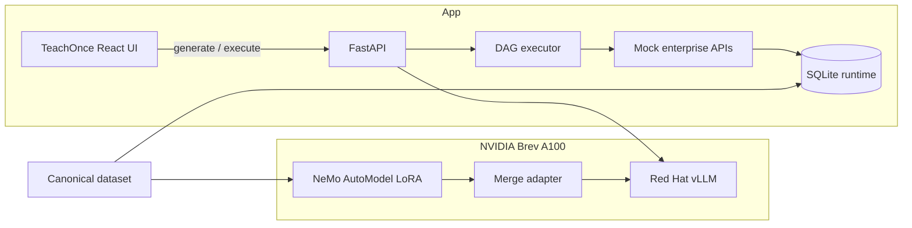

# TeachOnce — Project Plan

**Status:** Guiding specification + implementation plan  
**Hackathon:** NVIDIA × Red Hat Small Models Hackathon  
**Track:** Fine-Tuned & Specialized Models  
**Deadline:** October 18, 2026, 11:00 AM local event time  
**Principle:** Build the smallest real system that convincingly demonstrates the complete TeachOnce user story.

**MVP lens:** Ship Flows A–C only. Warranty process only. Happy path only. No multi-family generalization, no Test Lab, no Review Queue, no edge-case recovery. If it is not required to demo Teach → Generate → Execute (active) → Execute (expired) on one DAG, it is out.

This document is the project’s canonical plan. Update it when architecture or priorities change. Do not treat chat history as the source of truth.

**Related design docs:**

| Doc | Role |
|-----|------|
| [`implementation.md`](implementation.md) | **Living implementation tracker — maintain status here** |
| [`implementation-stages.md`](implementation-stages.md) | Detailed Phase 0+ how-to (commands) |
| [`hld.md`](hld.md) | High-level architecture, subsystem diagram, deployment topology |
| [`lld.md`](lld.md) | Schemas, APIs, executor algorithm, sequence diagram, module map |
| [`vLLM/brevsetup.pdf`](vLLM/brevsetup.pdf) | Hackathon Brev + vLLM setup handout |
| [`brev.md`](brev.md) | Live instance notes, versions, tunnel, restart *(created in Phase 0)* |

---

## Mandatory NVIDIA-only AI infrastructure policy

**TeachOnce must exclusively use NVIDIA models for all AI inference and model-training workloads.**

This applies to the entire application and development pipeline, including synthetic data augmentation, SOP rewriting, procedure extraction, training, workflow generation, evaluation, and production inference.

### Approved AI stack

| Role | Approved component |
|------|--------------------|
| Generative model | NVIDIA Nemotron Nano 9B v2 (`nvidia/NVIDIA-Nemotron-Nano-9B-v2`) |
| GPU compute | NVIDIA Brev |
| Training instance | 1× NVIDIA A100 80GB |
| Fine-tuning | NVIDIA NeMo AutoModel (LoRA) |
| Serving | Red Hat AI Inference Server (vLLM-based) hosting our Nemotron |
| App integration | FastAPI → self-hosted Brev inference only |

### Explicitly prohibited

Do **not** integrate or invoke:

- OpenAI API, Anthropic / Claude API, Google Gemini, Groq, OpenRouter, Together AI, Fireworks AI  
- Cursor-hosted model APIs  
- Any external LLM provider as an automatic fallback  

Do **not**:

- Add dependencies that silently route AI requests to those services  
- Use an external teacher model for synthetic data generation  
- Ship features that require OpenAI, Anthropic, Google, Cursor, or other third-party hosted LLM API keys  

If natural-language augmentation is needed, use an **NVIDIA model on approved Brev / Red Hat vLLM infrastructure**. Otherwise prefer **deterministic templates**.

### API compatibility (protocol vs provider)

Red Hat vLLM may expose an **OpenAI-compatible HTTP protocol**. That is allowed **only** when requests go to **our** Nemotron on Brev.

- An OpenAI-compatible SDK is permitted only when pointed at our self-hosted URL with **no** OpenAI (or other) fallback.  
- Prefer a clearly named internal gateway module (e.g. `services/nvidia_inference.py`).  
- Never rely on default external API endpoints or env vars that could send traffic to third parties.  

### Enforcement

1. Centralize all AI requests in one backend module (`backend/app/services/nvidia_inference.py`).  
2. Configure with **`NVIDIA_VLLM_BASE_URL`** (and allowlisted model IDs / hosts).  
3. **Reject** missing endpoint configuration — never fall back to an external provider.  
4. Maintain an allowlist of permitted model IDs and inference hosts.  
5. Audit the repo for external model SDKs, hardcoded third-party endpoints, hidden fallbacks, and AI-related outbound requests.  
6. No frontend component may call an AI provider directly.  
7. Keep training, inference, and optional text augmentation on approved NVIDIA infra.  
8. Document real hosting endpoints, checkpoint IDs, and serve commands in `docs/brev.md`.  
9. Verify the end-to-end demo’s model requests hit Brev-hosted Nemotron.  

### Cursor vs TeachOnce

Cursor may be used as the **development IDE / coding assistant**.

No TeachOnce application feature, backend service, training script, synthetic data generator, or evaluation tool may depend on Cursor’s hosted model API.

### Policy definition of done

All generative AI operations in TeachOnce are processed by NVIDIA Nemotron through approved infrastructure. The app must run without OpenAI, Anthropic, Google, Cursor, or other third-party hosted LLM API keys.

---

## 0. Repository reality check (as of plan authoring)

Workspace: `/Users/kedarvaidya/Downloads/NvidiaHack`

| Asset | Status |
|-------|--------|
| Application code | **None** — greenfield |
| Backend / executor / APIs | None |
| Canonical dataset / training JSONL | None |
| Fine-tune / vLLM artifacts | None |
| In-repo UI | None |
| Demo reference | [`mock.mp4`](../mock.mp4) |
| UI visual reference | External TeachOnce UI mock (visual reference only); rebuild/adapt into `frontend/` |

Nothing is “mocked in code” yet because there is no code. The UI mock is a polished client-only front-end reference only — **not** an AI provider integration and not part of the NVIDIA inference path.

---

## 1. What Is TeachOnce?

**TeachOnce: Teach a process once. Automate it repeatedly. Verify every outcome.**

TeachOnce is an AI-powered enterprise workflow-learning and automation platform.

### Problem

Enterprises have thousands of operational processes that live in SOP documents, policy manuals, employee knowledge, expert demonstrations, and internal systems. Automating them usually means engineers manually translating process knowledge into workflow logic, API integrations, conditional branches, and exception rules — expensive, slow, and hard to maintain.

### Solution

A business user teaches an AI a workflow using existing procedural knowledge and expert demonstrations. A **fine-tuned small language model** compiles that knowledge into an **executable workflow DAG**. The platform runs that DAG through connected enterprise tools and verifies outcomes.

We are **not** building a generic chatbot.

We are building a **procedure-to-executable-workflow compiler**, supported by a workflow execution and monitoring platform. The UX should feel like polished enterprise SaaS.

### Differentiation

> An organization can teach TeachOnce how a business process works, and TeachOnce converts that knowledge into an executable, inspectable, reusable automation.

The rest of the platform is largely deterministic software. One fine-tuned generative model compiles procedures → DAGs.

---

## 2. Hackathon context and priorities

Organizer guidance:

- Strong user story, product impact, and demonstration matter most.
- The AI model must **genuinely function**.
- No need for SOTA accuracy or exhaustive research benchmarks.
- A simple, reliable end-to-end happy path is enough.
- Limitations may be acknowledged honestly.

**Goal:** A highly polished product with a small number of coherent, working end-to-end flows — not a production-grade enterprise platform.

### Prioritize

1. Strong product storytelling  
2. Intuitive, polished frontend  
3. Genuinely functional fine-tuned model generating workflow DAGs  
4. Actual DAG execution against callable mock enterprise APIs  
5. End-to-end data consistency  
6. Clear business outcomes in the demo  
7. Basic execution tracking and monitoring  

### Do not prioritize (cut entirely for MVP)

Complex edge cases, held-out multi-family eval, Test Lab, Review Queue, autonomous multi-agent systems, enterprise auth/SSO, advanced failure recovery, real Salesforce/ServiceNow, multi-tenancy, large-scale benchmarking, K8s, etc.

---

## 3. Target user story (Northstar Computing)

**Enterprise:** Northstar Computing (computer manufacturer)  
**Primary user:** Customer Support Operations Manager  
**Flagship process:** Laptop hardware warranty / service resolution

### Step 1 — Teach

In Teach Studio, provide (from the canonical dataset):

- Warranty resolution SOP  
- Applicable policies  
- Expert demonstration(s)  
- Available tool / API definitions  

### Step 2 — Generate

Click **Generate Workflow**. Fine-tuned Nemotron receives a Procedure Package and returns executable DAG JSON (actions, decisions, branches, tool bindings, parameter mappings, dependencies, terminal outcomes). Frontend visualizes it in an interactive editor.

### Step 3 — Review and Deploy

Inspect the workflow and activate it. Sophisticated editing/versioning is out of scope for MVP.

### Step 4 — Execute

A support case arrives. The executor runs the DAG against mock enterprise APIs, for example:

1. Look up customer  
2. Get registered device  
3. Check warranty  
4. Get diagnostics  
5. Choose service path  
6. Create repair request if eligible  
7. Update support ticket  
8. Verify final outcome  

### Step 5 — Observe

Show visited nodes, branch taken, tool I/O, success/failure, business artifacts (e.g. repair order), and updated dashboard metrics.

---

## 4. Three essential demo flows

### Flow A — Teach an enterprise process

SOP + policy + expert demo → fine-tuned Nemotron → valid executable DAG → interactive visualization.

### Flow B — Execute a support workflow

Active-warranty hardware-failure case → executor + mock APIs → repair request created + ticket updated → UI shows node sequence and records.

### Flow C — Conditional reasoning

Same activated DAG, different case (e.g. expired warranty) → paid-service branch instead of covered repair → dashboard reflects both runs.

**MVP freeze:** Exactly these three flows. No fourth flow. No second SOP family on stage.

---

## 5. Canonical dataset (strict requirement)

**Generate one synthetic enterprise world once. Use it everywhere.**

Do **not** independently fabricate training examples, SOPs, demos, CRM rows, warranties, tool responses, test cases, expected outcomes, or UI fixtures. Everything derives from one coherent world with stable IDs and referential integrity.

### Recommended layout

```text
data/
  generated/
    manifest.json
    entities/
      customers.json
      devices.json
      warranties.json
      tickets.json
      diagnostics.json
    policies/
      policies.json
    tools/
      registry.json
    workflows/
      ground_truth.json
    demonstrations/
      traces.json
    documents/
      warranty_sop.md
      warranty_policy.md
    cases/
      demo.json              # active_warranty + expired_warranty cases for Flows B–C
    training/
      train.jsonl            # warranty-topology paraphrases / mild variants only
      validation.jsonl       # small holdout of same family (schema checks)
```

Folder names may adjust for repo convenience; the conceptual requirement cannot. **MVP size target:** enough entities for a believable UI (~20–50 customers/devices), **2 demo cases**, and a small train set focused on the one warranty DAG topology (paraphrase SOP/demo wording; do not invent other process families).

### One-time generator

Deterministic Python generator, fixed seed (plan default: **42**):

1. Define entities and relationships  
2. Define policies  
3. Define tool schemas / operations  
4. Define reference workflow specifications  
5. Generate support cases  
6. Derive expert demonstrations from reference workflows  
7. Render SOP / policy docs from the same rules  
8. Derive expected scenario outcomes  
9. Emit training / eval examples  
10. Validate consistency  

Freeze with `manifest.json` (version, seed, checksums). Do not regenerate casually.

### Immutable vs runtime state

| Layer | Role |
|-------|------|
| `data/generated/` | Immutable canonical world |
| Runtime DB (SQLite) | Initialized from dataset; mutated by executions (`CREATE_REPAIR`, `UPDATE_TICKET`, …) |
| Reset | Restore runtime from dataset **without** regenerating the world |

Isolate tests so runs do not corrupt each other unintentionally.

---

## 6. Training data and ground truth (MVP)

**Objective:** `(warranty SOP + policies + expert demos + tool defs) → one executable warranty DAG topology`

**MVP training goal:** Reliable JSON DAG for the Northstar warranty procedure. Enough paraphrase/mild structural variants that the model is compiling, not rote-copying one string. **Not** a multi-SOP research dataset.

| Include | Exclude |
|---------|---------|
| One ground-truth warranty DAG (active + expired branches) | Other process families (refund, delivery, escalation, …) |
| Paraphrased SOP / demo / policy text → same target topology | Large held-out families |
| Mild wording variants on tools/bindings | HPO, benchmark suites, SOTA claims |
| Tiny validation split for parse + schema pass rate | Memorizing case IDs / customer rows |

**Ground-truth DAGs come from the deterministic generator.** Prefer deterministic templates for text variation; any NL paraphrase uses the NVIDIA-only gateway — never an external teacher model.

- Validate every training example against the DAG schema  
- Demo generate must not return `ground_truth.json` disguised as model output  
- Gate: schema-pass on validation is “good enough to demo,” not a research bar  

---

## 7. AI model, GPU infrastructure, fine-tuning, and inference

### 7.1 Locked infrastructure (mandatory)

| Decision | Choice |
|----------|--------|
| GPU provider | **NVIDIA Brev only** |
| Do not use | Gaia server, local GPUs |
| Budget | ~**$160** Brev credits |
| Target GPU | **1× NVIDIA A100 80GB** |
| System RAM | ≥ 64 GB desired |
| Storage | ≥ 100 GB desired |
| Inference | **Red Hat AI Inference Server** (vLLM-based) — mandatory |
| Fine-tuning | **NVIDIA NeMo AutoModel**, LoRA SFT |
| Backend | FastAPI |
| Frontend | TeachOnce React UI (from external UI mock — visual reference only, not an AI API) |
| Cluster | Single instance — no Kubernetes / multi-node |

CPU app services may run on the same Brev VM or another reachable machine; prefer one box for demo simplicity.

### 7.2 Locked model (do not revisit unless blocked)

| Field | Value |
|-------|--------|
| Name | NVIDIA Nemotron Nano 9B v2 |
| Hugging Face ID | `nvidia/NVIDIA-Nemotron-Nano-9B-v2` |
| Architecture | Nemotron-H hybrid (Mamba-2 + MLP + few attention layers) |
| Parameters | **9B** (within 33B deployed generative cap) |
| Modality | Text-to-text |
| Task | Compile SOP + demos + policies + tool schemas → executable DAG JSON |

Hackathon rule: count **full** model weights toward the 33B cap (including MoE total weights). Verify rules before any second generative model is introduced. **Do not deploy a second generative model** without checking the budget.

### 7.3 Fine-tuning configuration

| Item | Value |
|------|--------|
| Framework | NVIDIA NeMo AutoModel |
| Method | LoRA supervised fine-tuning |
| Recipe baseline | `nemotron_nano_9b_squad_peft.yaml` ([NeMo Automodel](https://github.com/NVIDIA-NeMo/Automodel/blob/main/examples/llm_finetune/nemotron/nemotron_nano_9b_squad_peft.yaml)) |
| Dataset | Replace SQuAD with TeachOnce canonical `training/*.jsonl` |
| LoRA rank | 8 (initial) |
| LoRA alpha | 32 (initial) |
| Precision | BF16 where supported |
| Mamba note | Recipe excludes `*.out_proj` — custom kernels |

These hyperparameters are starting points, not validated optima. Prefer short smoke runs before longer training. No large HPO sweeps.

### 7.4 Inference serving (mandatory)

Use **Red Hat AI Inference Server / Red Hat’s vLLM distribution** hosting **our** Nemotron on Brev. See **Mandatory NVIDIA-only AI infrastructure policy** above.

- Load Nano 9B v2 + fine-tuned adapter in the **supported** form  
- **Merge LoRA before serve:** official Automodel CI sets `vllm_merge_lora: true` because vLLM cannot serve LoRA on fused Mamba layers  
- Expose an **OpenAI-compatible protocol** on our self-hosted URL only (`NVIDIA_VLLM_BASE_URL`) — not the public OpenAI API  
- Accept Procedure Package prompts; emit **DAG JSON only**  
- MVP serve flags: disable / minimize thinking-budget if the model emits reasoning by default; prefer JSON / constrained decoding when the Red Hat image supports it; otherwise prompt + strip fences + validate  
- FastAPI calls only through `services/nvidia_inference.py`; record `latency_ms`  
- Missing/misconfigured endpoint → hard fail (no third-party fallback)  
- **Demo operator note:** if live generate flakes once, retry once; keep the last validated model DAG in the UI/session so Flows B–C can still run — never silently load `ground_truth.json` as if it were a model response

Do **not** silently substitute another inference framework or provider. On Red Hat vLLM / Nemotron compatibility failure: identify the blocker and propose the smallest NVIDIA-stack fix (image pin, merge path, flags).

### 7.5 Model responsibility boundary

**Model does:** compile procedural knowledge → typed executable DAG JSON.

**Model does not:** mutate DBs directly, manage credentials, execute business ops, invent tool outcomes, decide success without real tool results, or invent dashboard stats.

### 7.6 Inference-time Procedure Package

Provide explicitly at generate time:

- Workflow goal  
- SOP content  
- Policy rules  
- Demonstration trace(s)  
- Tool schemas  
- Source identifiers  

Do not assume the model “memorized” Northstar policy from fine-tuning alone.

### 7.7 Budget priority

1. Verify model load + base inference on Brev  
2. One practical LoRA fine-tune  
3. Serve trained (merged) model via Red Hat vLLM; test DAG generation  
4. Reserve credits for the live demo  

Stop idle GPU instances. Document instance type, $/hr, train/serve commands in `docs/brev.md`.

If A100 80GB is unavailable: report blocker; recommend equivalent **≥80 GB VRAM** GPU.

### 7.8 AI infrastructure definition of done

1. Nano 9B v2 fine-tuned on canonical data using Brev  
2. Served through Red Hat vLLM  
3. Teach Studio sends a real generate request  
4. Model returns an actual DAG  
5. DAG passes validator  
6. That DAG drives the deterministic executor  

**Final demo:** `/workflows/generate` must hit Brev Nemotron. Executor may be rehearsed earlier against a stored validated DAG from a prior successful generate. Never present `ground_truth.json` as live model output.

---

## 8. Workflow DAG specification

The DAG is an executable program, not only a visualization.

### MVP node types

- `START`  
- `ACTION` — references tool registry operation + typed input bindings  
- `DECISION` — exactly **two** branches for the warranty demo (`ACTIVE` vs `EXPIRED`); complete outgoing edges  
- `END`  

No review/approval nodes in MVP.

### Bindings and predicates

Inputs may reference: initial case data, prior node outputs, constants.

**No arbitrary generated Python/JS.** MVP predicates: mostly `eq` / `neq` on `warranty_status` (plus `exists` if needed). Skip exotic ops unless the ground-truth DAG needs them.

### Validator checks (keep simple)

Valid types; unique IDs; one `START`; valid edges; acyclic; reachable `END`s; decision branches covered; tool ops exist; required inputs bound.

MVP avoids loops, retries, parallel nodes, dynamic planning, and default/else machinery beyond the two explicit warranty branches.

---

## 9. Mock enterprise integrations

Callable APIs (unified FastAPI with adapters), not UI placeholders.

| Service | Operations |
|---------|------------|
| CRM | `LOOKUP_CUSTOMER`, `GET_TICKET`, `UPDATE_TICKET` |
| Device Registry | `GET_DEVICE` |
| Warranty | `CHECK_WARRANTY` |
| Diagnostics | `GET_DIAGNOSTICS` |
| Repair | `CREATE_REPAIR` (active path); `RECORD_PAID_OPTIONS` (expired path artifact) |

Typed I/O contracts. Model receives schemas at compile time. Executor calls real adapters. Handlers read/write runtime DB seeded from the canonical world. UI displays those actual records.

---

## 10. Workflow execution engine

Deterministic DAG executor.

**Input:** approved/generated DAG, case ID, runtime state.

**Steps:** init context → traverse from START → evaluate decisions → resolve ACTION bindings → call adapters → capture I/O → update context → follow edges → END → verify business state → record outcome.

**Persist:** execution ID, case/workflow IDs, timestamps, status, visited nodes, tool I/O, decision results, artifacts, errors.

Same executor for active- and expired-warranty paths. **Never** invent outcomes by hardcoding demo case IDs; always follow the DAG.

---

## 11. Frontend and product experience

Treat the external TeachOnce UI mock / `mock.mp4` as the **visual and interaction reference** only (not an AI provider). Copy the IA; do not redesign.

### Screens (MVP only)

| Screen | Role |
|--------|------|
| Overview | Seeded + live metrics, recent live executions |
| Teach Studio | SOP/demo → **Generate Workflow** → Nemotron |
| Workflow Editor | React Flow viz, activate |
| Executions | Pick demo case, run, event timeline, artifacts |
| Integrations | Static tool registry list (optional ping) |

**Cut for MVP:** Test Lab, Review Queue, editing/versioning, multi-SOP picker.

### UI requirements

- Polished enough to look like enterprise SaaS  
- Prominent Generate / Run  
- Render **model-generated** DAG JSON  
- Show real executor events and side effects (repair order **or** paid-options record)  
- Consistent Northstar IDs  

Stack: React, TypeScript, Tailwind, React Flow, Recharts (Vite under `frontend/`).

---

## 12. Demo metrics and honesty

Dashboard may show seeded illustrative history, but distinguish:

- Seeded synthetic historical records  
- Live demo executions  
- Measured model/eval results  

Do not fabricate SOTA gains, real customer adoption, production integrations, or dollar savings. Live runs must update logs, artifacts, and relevant counts consistently.

---

## 13. Explicit non-goals (MVP)

- Any second workflow family or SOP on the demo path  
- Test Lab / Review Queue / approval routing  
- Multi-family training / research eval suites  
- Fancy failure recovery, retries beyond one compile retry  
- General-purpose multi-agent systems, RAG, video/browser capture  
- Production OAuth/SSO, multi-tenancy, real CRM/ITSM  
- Distributed orchestration / K8s / production hardening  
- Non-NVIDIA hosted LLMs (see mandatory policy)

---

## 14. Application architecture

```text
Teach Studio
  → FastAPI POST /workflows/generate
  → Red Hat vLLM (fine-tuned Nano 9B on Brev)
  → JSON DAG
  → schema validation
  → Workflow Editor
  → deterministic executor
  → mock enterprise APIs
  → execution logs + dashboard
```



### Target repo layout

```text
NvidiaHack/
  docs/
    plan.md                 # this file
    brev.md                 # instance, pricing, train/serve, stop/start
  data/generated/           # frozen canonical world
  backend/
    app/
      main.py
      schema/dag.py
      tools/
      executor/
      generate/             # procedure compile orchestration + validate
      services/
        nvidia_inference.py # SOLE AI outbound path → Brev Nemotron
      db.py
    requirements.txt
  frontend/                 # TeachOnce React UI (no direct AI provider calls)
  ml/                       # train/eval only against NVIDIA / Brev stack

    recipes/
      nemotron_nano_9b_teachonce_peft.yaml
    prepare_automodel_dataset.py
    merge_lora.py
    eval_compiler.py
    smoke_infer.py
  scripts/
    generate_dataset.py
    validate_dataset.py
    reset_runtime.py
  README.md
  mock.mp4
```

### Backend API (minimum)

| Method | Path | Purpose |
|--------|------|---------|
| GET | `/dataset/procedure-package/warranty` | Teach Studio inputs |
| POST | `/workflows/generate` | Model compile → validate → persist |
| POST | `/workflows/{id}/activate` | Make runnable |
| GET | `/cases`, `/cases/{id}` | Support cases |
| POST | `/executions` | Run DAG for case |
| GET | `/executions`, `/executions/{id}` | History + detail |
| GET | `/metrics/overview` | Seeded + live metrics |
| POST | `/admin/reset` | Restore runtime from dataset |

Dev-only ground-truth generate flag may exist for executor testing **before** the model is ready; **disabled for final demo**.

---

## 15. Implementation order

**Living tracker:** [`implementation.md`](implementation.md) · **Detailed how-to:** [`implementation-stages.md`](implementation-stages.md).

| Phase | Focus | Gate |
|-------|--------|------|
| **0** | Brev + **vLLM** + **NeMo Gym** (small instruct model; Gym → local vLLM only; see [`vLLM/brevsetup.pdf`](vLLM/brevsetup.pdf)) | Phase 0 checklist in implementation-stages |
| **1** | Tiny warranty dataset + DAG executor + FastAPI stubs | Active + expired on ground-truth DAG |
| **2** | Nemotron Nano 9B LoRA + serve + `nvidia_inference` | Live `/workflows/generate` |
| **3** | TeachOnce React UI (MVP screens) | Flows A–B |
| **4** | Demo polish (Flow C, script, NVIDIA-only audit) | DoD §17 |

**Phase 0 is infra only** — do not fine-tune Nemotron or build the app until vLLM + Gym smoke is green. NeMo Gym must not use `api.openai.com`.

**No Test Lab / Review Queue** before Flows A–C are reliable.

---

## 16. Risks and mitigations

| Risk | Mitigation |
|------|------------|
| A100 unavailable / budget burn | Check capacity/price first; ≥80 GB alt; stop idle GPUs; smoke before long train |
| vLLM + LoRA on Mamba | Always merge LoRA; verify Red Hat image supports Nemotron-H |
| NeMo recipe assumes multi-GPU | `--nproc-per-node 1` on single A100; shrink batch/seq on OOM |
| Flaky DAG JSON | JSON-only prompt / thinking off; validator; one retry; warranty-only data |
| Deadline | Ship Phase 0→4 (infra → A–C demo) only; refuse Test Lab / Review Queue / non-goals |
| Phase 0 Gym defaults to OpenAI | Force `vllm_model` + local `NVIDIA_VLLM_BASE_URL`; never `api.openai.com` |
| Dataset drift across UI | Single `data/generated` + SQLite; no per-screen fixtures |
| Generate fails on stage | Retry once; reuse last validated model DAG in session — never silent GT swap |

---

## 17. Definition of done (product)

Demonstrate without disconnected staged data:

1. Open Teach Studio  
2. Select warranty SOP + expert demo from canonical dataset  
3. Invoke fine-tuned Nemotron via Red Hat vLLM  
4. Receive a valid workflow DAG from the model  
5. Visualize it in the workflow editor  
6. Select a support case from the same dataset  
7. Execute against callable mock APIs  
8. Observe the correct decision branch  
9. See repair order or appropriate alternative outcome  
10. Inspect execution events and real tool results  
11. See the run on the dashboard  
12. Optionally run a second case on a different branch of the **same** DAG  

**Deliverable:** one coherent, functioning product demo — not disconnected mocks.

---

## 18. Immediate next steps

1. Track progress in [`implementation.md`](implementation.md); execute **Phase 0** using [`implementation-stages.md`](implementation-stages.md) + [`vLLM/brevsetup.pdf`](vLLM/brevsetup.pdf).  
2. Write `docs/brev.md` + `scripts/start_*.sh` / `smoke_test.sh` after green Gym↔vLLM smoke; check off Phase 0 in `implementation.md`.  
3. Only then: Phase 1 dataset/runtime and Phase 2 Nemotron LoRA.  
4. Keep Cursor plan todos aligned with `implementation.md`.

---

## Document history

| Date | Change |
|------|--------|
| 2026-10-17 | Initial complete plan: product context + locked Brev/Nano 9B/NeMo/Red Hat vLLM architecture + greenfield repo findings + milestone order |
| 2026-10-17 | Added links to `hld.md` and `lld.md` |
| 2026-10-17 | Added Mandatory NVIDIA-only AI infrastructure policy; banned third-party LLM providers/fallbacks |
| 2026-10-17 | Pointed §15/§18 at `implementation-stages.md`; Phase 0 = vLLM + NeMo Gym before Nemotron |
| 2026-10-17 | MVP cut: warranty-only A–C; drop multi-family training, Test Lab, Review Queue, edge-case scope |
| 2026-10-17 | Added `implementation.md` as living tracker |
