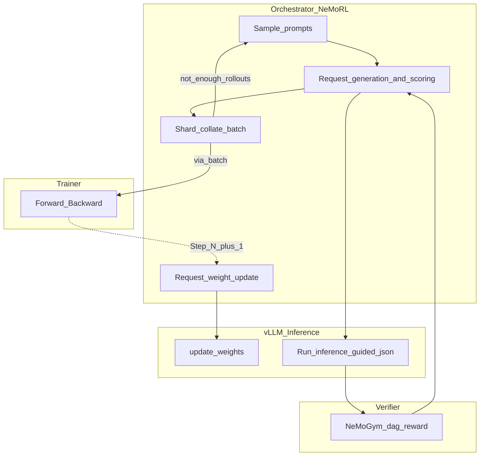
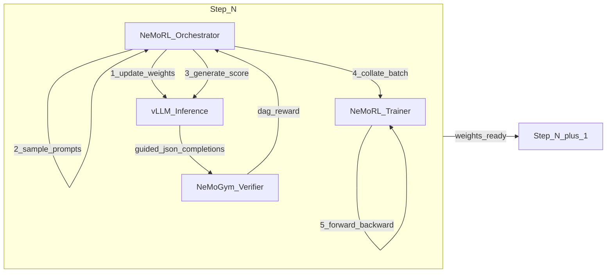

# TeachOnce RL — vLLM + NeMo-RL + Gym

**Status:** Canonical hot-path architecture for Stage 3 (GRPO)  
**Companion:** [`training-design.md`](training-design.md) · config sketch [`configs/nemo_rl_gym_nemotron_vl.yaml`](../configs/nemo_rl_gym_nemotron_vl.yaml)  
**Model:** `nvidia/NVIDIA-Nemotron-Nano-12B-v2-VL-BF16`

---

## Purpose

Specialize Nemotron VL so rollouts are **always schema-valid DAG JSON**, then RL improves **ops / branch** quality via `dag_reward`.

Schema is enforced at **decode** (`guided_json`), not learned as a sparse reward. Free HF `generate` without guidance yields `schema_ok=0` → zero advantages → no learning.

---

## Locked machine split

| Box | Role | What runs |
|-----|------|-----------|
| **teachonce-rl (H100, CUDA 12.8)** | Hot path | NeMo-RL GRPO owns vLLM (`expose_http_server`) + trainer + weight refit; Gym as verifier |
| **teachonce-gpu (A100)** | Cold eval | External vLLM on `127.0.0.1:8000` for baseline / holdout (video + `guided_json`) only |

**Do not** push `/update_weights` across the WAN every step (A100 serve + H100 train). Weight refit needs IPC/NCCL next to the trainer.

---

## Where vLLM fits (lane diagram)

Matches the Red Hat “Where Does vLLM Fit in RL?” model: Trainer · Orchestrator · vLLM · Verifier.



### Step N → Step N+1 (compact)



### Per-step sequence

1. **Weight update** — Orchestrator → vLLM `/update_weights` (or NeMo-RL IPC/NCCL refit into owned workers).
2. **Sample prompts** — from train GT buffer.
3. **Generate + score** — `/v1/chat/completions` + `guided_json` (registry `oneOf`); Gym / `dag_reward` returns scalars.
4. **Collate** — shard accepted rollouts into a train batch; if not enough, resample.
5. **Train** — forward + backward on policy; loop to Step N+1.

---

## API surface

| Endpoint / mechanism | Role |
|----------------------|------|
| `POST /v1/chat/completions` | Rollouts (video and/or text+events) |
| `guided_json` / `structured_outputs.json` | Force DAG schema — same as [`scripts/baseline_vllm_dag.py`](../scripts/baseline_vllm_dag.py) `guided_schema()` |
| `/update_weights` or NeMo-RL `update_weights_from_collective` / `update_weights_via_ipc_zmq` | Push trainer weights into live vLLM without full restart |

Schema source of truth: MVP registry `oneOf` ACTION nodes (`op`+`tool` locked), `maxItems` on nodes/edges to stop runaway ACTION loops.

---

## Reward contract

Defined in [`scripts/nemo_rl_gt.py`](../scripts/nemo_rl_gt.py) → `dag_reward`:

| Term | Weight | In this architecture |
|------|--------|----------------------|
| `schema_ok` | 0.4 | **Gate at decode** — should stay ~1.0 under `guided_json` |
| `critical_ops` | 0.3 | **RL objective** |
| `taken_branch` | 0.3 | **RL objective** |

RL signal = variance on ops/branch across the G group, not “did JSON parse.”

---

## Data

| Split | Path |
|-------|------|
| Train (balanced 50) | [`data/generated/nemo_rl/gt_train_balanced50.jsonl`](../data/generated/nemo_rl/gt_train_balanced50.jsonl) |
| Holdout (balanced 24) | [`data/generated/nemo_rl/gt_holdout_balanced24.jsonl`](../data/generated/nemo_rl/gt_holdout_balanced24.jsonl) |

Holdout IDs are frozen for fair compare to baseline / SFT video eval on A100.

---

## Checkpoint handoff

```
base Nemotron VL
  → Ckpt B   (product SFT LoRA)
  → merge    (required: vLLM has no LoRA for NemotronH_Nano_VL_V2)
  → Ckpt C   (NeMo-RL GRPO on H100, guided rollouts + weight refit)
  → merge / export
  → A100 vLLM holdout eval (video + guided_json)
```

---

## Config / scripts

| Artifact | Use |
|----------|-----|
| [`configs/nemo_rl_gym_nemotron_vl.yaml`](../configs/nemo_rl_gym_nemotron_vl.yaml) | NeMo-RL + Gym sketch (`generation.backend: vllm`, `expose_http_server`) |
| [`scripts/baseline_vllm_dag.py`](../scripts/baseline_vllm_dag.py) | Eval protocol + `guided_schema()` |
| [`scripts/smoke_gym_nemotron_vl.sh`](../scripts/smoke_gym_nemotron_vl.sh) | Gym ↔ vLLM smoke |
| [`scripts/rl_vllm_guided_rft.py`](../scripts/rl_vllm_guided_rft.py) | Simple H100 path: guided rollouts → reward-weighted SFT (bridge until full NeMo-RL) |
| [`scripts/run_rl_vllm_guided_h100.sh`](../scripts/run_rl_vllm_guided_h100.sh) | Launch helper on `teachonce-rl` |

---

## Do not use as primary RL

| Path | Why |
|------|-----|
| [`scripts/grpo_dag_wandb.py`](../scripts/grpo_dag_wandb.py) HF free `generate` | No `guided_json` → `schema_ok=0` → loss/advantages stay 0 |
| Cross-box weight sync every step | 12B over WAN; NCCL/IPC expect colocation |

---

## Implementation north star

1. Hot path on **H100**: NeMo-RL owns vLLM + GRPO + Gym/`dag_reward`.
2. Cold path on **A100**: holdout-24 video eval with same guided schema as baseline.
3. Until NeMo-RL GRPO is fully stood up: use guided RFT bridge scripts on H100 (schema-enforced rollouts, then LoRA fit on rewarded completions).
