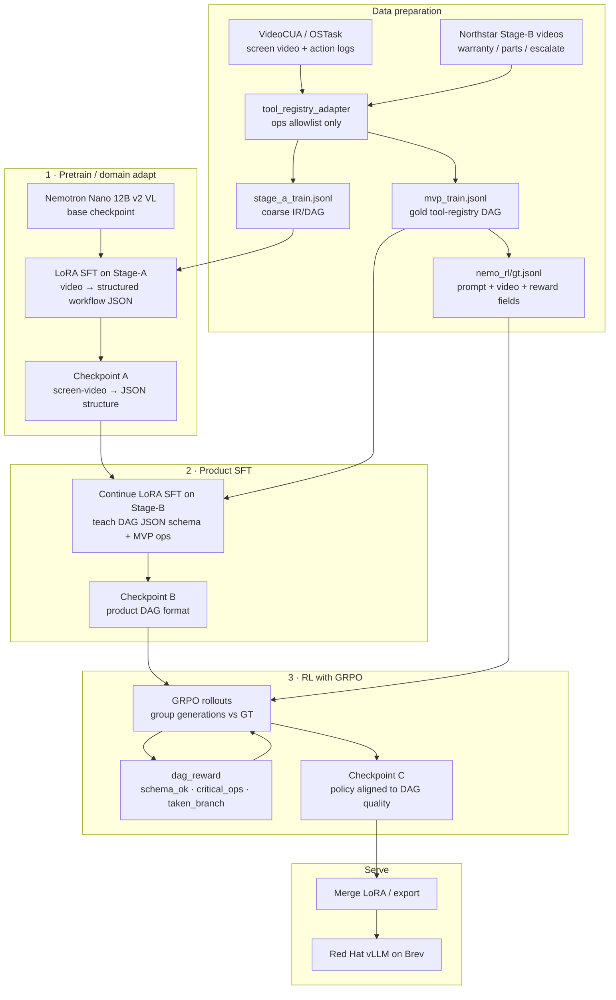

# TeachOnce — Training Design

**Status:** Canonical offline train path  
**Companion docs:** [`plan.md`](plan.md) §6–7, [`phases/phase-1-dataset.md`](phases/phase-1-dataset.md), [`phases/phase-2-nemotron.md`](phases/phase-2-nemotron.md), [`hld.md`](hld.md), [`brev.md`](brev.md)  
**Model:** `nvidia/NVIDIA-Nemotron-Nano-12B-v2-VL-BF16`  
**Serve:** Red Hat AI Inference Server (vLLM) on Brev  

---

## Goal

Specialize Nemotron VL so `(screen video [+ optional SOP] + tool defs) → executable DAG JSON` over the MVP tool registry.

**Hackathon order (from baseline):** fix path-consistent GT → product SFT (raise op recall) → GRPO. Skip Stage-A unless SFT plateaus. Serve with registry `guided_json` `oneOf`.

Three stages:

1. **Pretrain** — domain adapt on public screen video (VideoCUA) — optional if Stage-B ready  
2. **SFT** — teach product DAG JSON format + registry ops (path-consistent gold)  
3. **RL (GRPO)** — align generations to `dag_reward`  

**Progress / checkpoints:** `scripts/run_train_pipeline.sh` → `checkpoints/train_pipeline_progress.json` + `checkpoints/sft_nemotron_vl/progress.json`; LoRA saved every `SFT_CKPT_EVERY` steps (`step_N`, `epoch_N`, `latest`, resume via `SFT_RESUME=1`).

---

## Pipeline



---

## Stage table

| Stage | Name | Data | Objective | Framework |
|-------|------|------|-----------|-----------|
| **1** | Pretrain / domain adapt | VideoCUA (+ OSTask MVP) → remapped IR/DAG via adapter | Teach VL: screen video → structured workflow JSON | NeMo AutoModel LoRA SFT |
| **2** | Product SFT | ~50 Northstar videos (warranty / parts / escalate), gold DAGs | Teach our DAG JSON schema + MVP registry ops / topologies | Continue LoRA SFT from Ckpt A |
| **3** | RL (GRPO) | `data/generated/nemo_rl/gt.jsonl` from Stage-B gold | Maximize `dag_reward` (schema / critical ops / taken branch) | **Canonical:** [`rl-vllm-gym-architecture.md`](rl-vllm-gym-architecture.md) (vLLM `guided_json` + `/update_weights` + NeMo-RL + Gym). Bridge: [`scripts/rl_vllm_guided_rft.py`](../scripts/rl_vllm_guided_rft.py). Do not use HF free-generate [`grpo_dag_wandb.py`](../scripts/grpo_dag_wandb.py) as primary. |

Stage-B recording recipe: [`prompts/synthetic-finetune-videos.md`](prompts/synthetic-finetune-videos.md).  
MVP Stage-A media: [`phases/mvp-train-subset.md`](phases/mvp-train-subset.md).

---

## Checkpoint handoff

```
base Nemotron VL
  → Ckpt A  (pretrain on stage_a_train.jsonl)
  → Ckpt B  (continue SFT on mvp_train.jsonl)
  → Ckpt C  (GRPO on nemo_rl/gt.jsonl + dag_reward)
  → merge / export
  → Red Hat vLLM
```

Every train row passes [`scripts/tool_registry_adapter.py`](../scripts/tool_registry_adapter.py) so DAGs only use MVP registry ops — never raw clicks as product nodes.

---

## Reward (Stage 3)

Defined in [`scripts/nemo_rl_gt.py`](../scripts/nemo_rl_gt.py) → `dag_reward`:

| Signal | Meaning |
|--------|---------|
| `schema_ok` | Valid executable DAG JSON (nodes/edges/types) |
| `critical_ops` | Family-defining registry ops present |
| `taken_branch` | Correct branch tip for filmed path (active/expired/…) |
| `reward` | Aggregate used by GRPO |

Build GT: `python3 scripts/nemo_rl_gt.py --from-split data/generated/splits/mvp_train.jsonl --out data/generated/nemo_rl/gt.jsonl`

---

## Eval

NeMo Gym `teachonce_ir` on holdout, measured at:

1. Base (pre-train)  
2. Post-SFT (Ckpt B)  
3. Post-GRPO (Ckpt C)  

Demo gate: schema-pass on validation is “good enough to demo,” not a research bar. See [`plan.md`](plan.md) §6.

---

## Related scripts

| Script | Role |
|--------|------|
| `scripts/download_video_sources.py` / `ingest_stage_a.py` | Stage-A media → schema rows |
| `scripts/build_mvp_split.py` | Stage-B gold split |
| `scripts/nemo_rl_gt.py` | Stage-B → GRPO GT JSONL |
| `scripts/sft_nemotron_vl_wandb.py` / `run_sft_nemotron_vl.sh` | SFT path |
| `scripts/grpo_dag_wandb.py` / `run_grpo_dag_wandb.sh` | GRPO path |
| `scripts/baseline_vllm_dag.py` | Pre-train vLLM + `dag_reward` baseline |

---

## Note vs older “two-stage” wording

[`plan.md`](plan.md) §6 and [`phases/phase-2-nemotron.md`](phases/phase-2-nemotron.md) still say two-stage (A domain-adapt → B product SFT). **This doc is authoritative for the full train path:** those two stages plus GRPO before merge/serve. Update those files when convenient so they point here.
